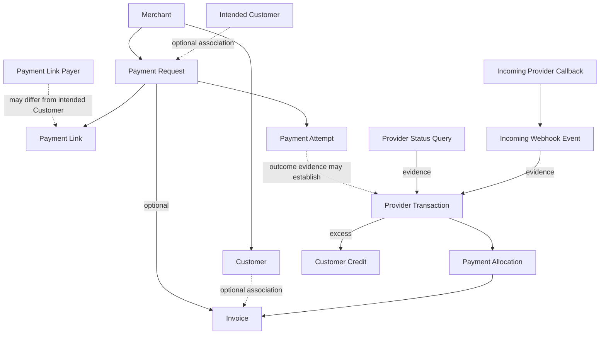

# Domain Docs

How the engineering skills should consume this repo's domain documentation when exploring the codebase.

## Before exploring, read these

- **`GLOSSARY.md`** at the repo root.
- **`GLOSSARY-MAP.md`** at the repo root if it exists: read the context glossaries relevant to the topic.
- **`docs/adr/`**: read ADRs that touch the area before work begins.
- In a multi-context repository, check context-scoped `docs/adr/` directories.

If these files do not exist, proceed silently. Do not suggest creating them unless domain modelling is resolving the missing concept or decision.

## Use the glossary's vocabulary

When an output names a domain concept, use the term defined in `GLOSSARY.md`. Do not silently replace it with a synonym.

If a concept is absent, note it as a potential domain gap for `/domain-modeling`.

## Peylora payment domain

The agreed domain model separates what was requested, how an attempt reached a provider, what the provider confirmed, and how money was allocated.



### Responsibilities

- **Merchant:** owns the business, collection configuration and payment records.
- **Customer:** is the person or organisation represented in a Merchant's customer record and may be associated with an Invoice or Payment Request.
- **Intended Customer:** is the Customer associated with a Payment Request when the Merchant has supplied or chosen one. Association is not mandatory.
- **Payment Link Payer:** is the person who actually initiates a payment through a public link. They may differ from the intended Customer.
- **Payment Request:** represents a fixed amount the Merchant intends to collect. It may be standalone or associated with an Invoice.
- **Payment Attempt:** represents one collection initiation and preserves that initiation's provider identifiers and operational events.
- **Provider Transaction:** represents the external provider's actual transaction and associated confirmed outcome.
- **Payment Allocation:** assigns received money to an Invoice balance or another collection obligation.
- **Customer Credit:** retains received money that was not allocated to an obligation.
- **Payment Link:** exposes a Payment Request through a customer-facing collection interface.
- **Invoice:** represents an itemised bill and its financial position.
- **Webhook Event:** records an incoming external provider callback or integration event requiring processing and retry handling.
- **Settlement:** represents collected funds becoming available to the Merchant under the provider or banking arrangement.
- **Reconciliation:** compares provider outcomes, allocations and settlement information to identify discrepancies.

### Relationships

- One Merchant has one or more Customers, but a Customer is not mandatory for every Payment Request or Invoice.
- One Payment Request belongs to one Merchant and can be standalone or associated with one Invoice.
- A Payment Request may identify an intended Customer, while a public-link payer is recorded separately if and when Customer identity is available.
- One Invoice can have multiple Payment Requests.
- One Payment Request can have multiple Payment Attempts.
- An unsuccessful or timed-out Payment Attempt does not necessarily produce a Provider Transaction.
- A Provider Transaction is established from provider evidence, such as callbacks or status queries, and remains distinct from the Payment Attempt.
- One successful Provider Transaction can allocate money to an Invoice and can create Customer Credit.
- One Payment Link points to one existing Payment Request. It does not own a separate financial balance.

These are domain relationships, not a mandate that every concept requires a separate database table.

## Invoice and payment lifecycle

Supported Invoice lifecycle statuses are:

- `SENT`
- `PARTIALLY_PAID`
- `PAID`
- `OVERDUE`
- `CANCELLED`

Invoice financial position is separate from its lifecycle status:

- **Amount allocated:** the portion of received money assigned to the Invoice.
- **Outstanding balance:** the Invoice amount remaining after allocated money.
- **Partial payment:** a successful payment or cumulative successful payments that allocate less than the outstanding balance.
- **Full payment:** allocated money satisfies the complete outstanding balance.
- **Due date:** the date from which payment is overdue by calendar or contract rules.
- **Overdue:** a lifecycle condition based on the due date and the invoice's remaining financial position.

Invoice status is derived from financial position and lifecycle rules after allocations are recorded. The initial agreed statuses do not establish whether `PARTIALLY_PAID` or `OVERDUE` takes precedence when an overdue Invoice is also partially paid. That precedence remains an open decision.

Multiple successful payments can contribute to an Invoice. A provider success must trigger allocation and balance recalculation before financial position and lifecycle status are derived.

Example:

```text
Invoice total:       10,000
Payment received:     4,000  -> allocated 4,000
Outstanding:          6,000
Invoice status:       PARTIALLY_PAID

Payment received:     6,000  -> allocated 6,000
Outstanding:          0
Invoice status:       PAID
```

For a 5,000 invoice balance and 6,000 received:

```text
Amount received:      6,000
Amount allocated:     5,000
Customer credit:      1,000
Outstanding:          0
Invoice status:       PAID
```

The full received amount remains in financial history. Excess money must not be silently discarded.

## Payment Request and attempt lifecycle

A Payment Request has a fixed amount chosen by the Merchant/server. Customers cannot edit the amount in the normal M-Pesa STK flow.

Each STK initiation represents a separate Payment Attempt:

- The attempt receives its own Daraja identifiers.
- Cancelled, failed and timed-out attempts remain in history.
- A retry creates a new attempt under the existing Payment Request.
- Previous attempts are never overwritten.
- A network timeout is distinct from a confirmed provider failure.
- An idempotency key identifies one initiation operation, not the lifetime of a Payment Request.

A Payment Attempt may experience multiple operational events. A callback or provider status query is evidence used to establish or update the attempt's Provider Transaction outcome. The attempt is the collection initiation; the Provider Transaction is the external transaction and confirmed provider result.

An unsuccessful initiation may remain without a Provider Transaction. It must not be inferred as a successful provider outcome merely because callback or status evidence is unavailable.

Provider outcome and collection satisfaction are separate:

- Provider success means the provider confirmed a successful transaction.
- Collection satisfaction depends on the amount received and the allocation required.
- A partial or excess payment is still a successful Provider Transaction.
- An invoice is fully paid only when its outstanding balance is satisfied.

## Payment Link behaviour

A Payment Link exposes an existing Payment Request. It is not a payment or transaction.

- A standalone link points to a standalone Payment Request.
- An invoice-linked link points to a Payment Request associated with that invoice.
- Reusable links point to the same Payment Request and can expose repeated attempts.
- Reusable collection templates that generate separate per-Customer requests are outside the initial scope.
- A satisfied, expired or disabled request must not accept further collections.
- A link can be disabled independently of the underlying Payment Request; disabling or expiring a link does not establish that the request itself is disabled or expired.
- Exact single-use semantics remain unresolved. The link's behaviour after a successful payment must be decided explicitly rather than inferred from request satisfaction.

## Financial integrity

Every financial operation must preserve:

- Amount requested
- Amount received
- Amount allocated
- Outstanding invoice balance
- Unapplied Customer Credit

Duplicate provider callbacks must not create duplicate financial records, allocations or credits. Financial processing must be idempotent and transactionally consistent.

Provider success does not prove:

- Invoice settlement
- Full balance satisfaction
- Provider settlement to the Merchant

Reconciliation verifies consistency. Settlement confirms movement and availability of funds.

## Current implementation snapshot

The existing application partially represents this model. It is important not to present partially implemented concepts as complete.

| Concept or rule | Existing implementation | Current gap |
|---|---|---|
| Payment Request | `payments` stores amount, status, phone, merchant and optional invoice/link associations. | Request, aggregate status and payment attempt are conflated. |
| Payment Attempt | `transactions` is created during STK initiation and stores checkout identifiers. | It combines attempt and provider outcome; normal retries do not create another transaction under an existing payment. |
| Provider Transaction | `transactions` stores callback result, receipt, paid amount and `amount_matches`. | Provider outcome and collection allocation are not separated. |
| Invoice | `invoices` and `invoice_items` exist; totals are calculated from line items. | `PARTIALLY_PAID` is missing; status is not allocation-derived. |
| Partial payments | Payments can reference an invoice. | No allocation or outstanding-balance ledger exists. |
| Overpayments/credit | Mismatched received amounts are retained in `paid_amount`. | No Customer Credit balance or allocation record exists. |
| Payment Link | `payment_links` points to an optional payment and optional invoice. | Public links create normal payment records; single-use/reusable request semantics are incomplete. |
| Incoming provider callback processing | Daraja callbacks are persisted in `webhook_events` with a unique checkout event key and processed transactionally. | Callback authenticity/signatures are not implemented; this table does not represent outgoing merchant webhooks. |
| Timeout | `TIMEOUT` appears in database enums and UI/API schemas. | No timeout scheduler or lifecycle transition creates this state. |
| Settlement | No settlement entity exists. | Settlement and settlement reports are missing. |
| Reconciliation | The reconcile endpoint queries Daraja and stores the response. | It does not change status, match allocations or settlement records, or detect financial discrepancies. |

Verified implementation references:

- Core tables: `migrations/001_initial_schema.sql:36-121`
- Invoice/payment associations: `migrations/007_invoice_payment_associations.sql:1-8`
- STK and payment creation: `src/controllers/mpesa.controller.js:23-141`
- Request and transaction persistence: `src/services/transaction.service.js:19-111`
- Callback amount and state handling: `src/services/transaction.service.js:369-453`
- Callback matching and deduplication: `src/services/transaction.service.js:490-557`
- Invoice total and status operations: `src/services/invoice.service.js:12-199`
- Invoice-link creation: `src/services/invoice.service.js:220-252`
- Payment-link public collection: `src/controllers/payment-link.controller.js:83-113`

## Open Domain Questions

- Can one Payment Request ever be associated with multiple invoices?
- Can a Merchant amend a Payment Request amount after creation?
- How should Customer Credit be created, applied to another obligation, refunded or audited?
- What lifecycle should be used for pending attempts when an invoice is cancelled or expires?
- Which lifecycle status takes precedence when an overdue Invoice is also partially paid?
- How are exact expiry and disabled/request-satisfied rules enforced for each Payment Link?
- What are the exact single-use completion and reuse semantics for a Payment Link?
- How should late provider callbacks be treated after an attempt has timed out?
- How should concurrent successful payments be allocated to an invoice?
- When may a partial or overpayment be considered collection satisfaction versus a disputed/mismatch state?
- Which provider or banking record is authoritative for Settlement?
- How will reconciliation distinguish callback data, provider status queries and settlement records?
- Should a standalone Payment Request be allowed to produce a reusable link template or only a single-use link?

## Flag ADR conflicts

If an implementation or proposal contradicts an existing ADR, surface the conflict explicitly rather than silently overriding it.
